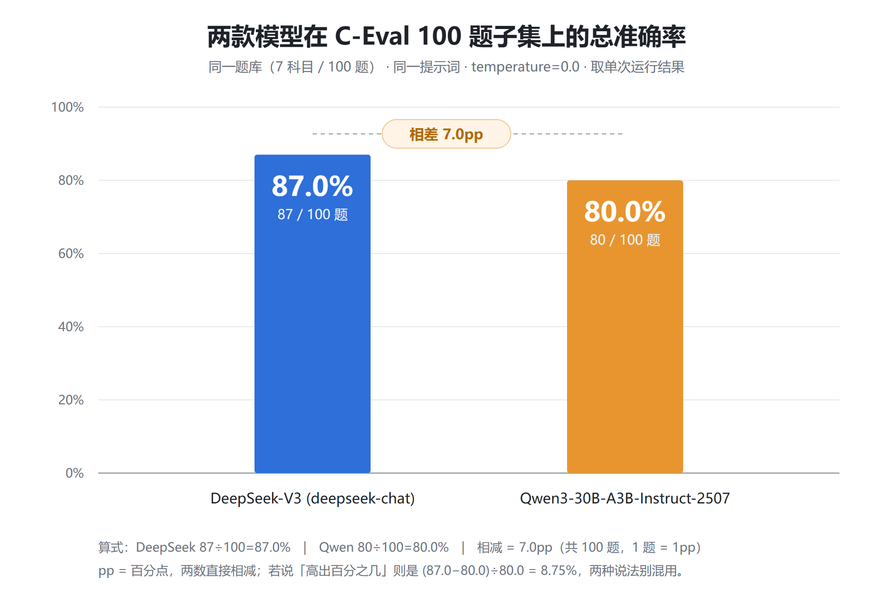
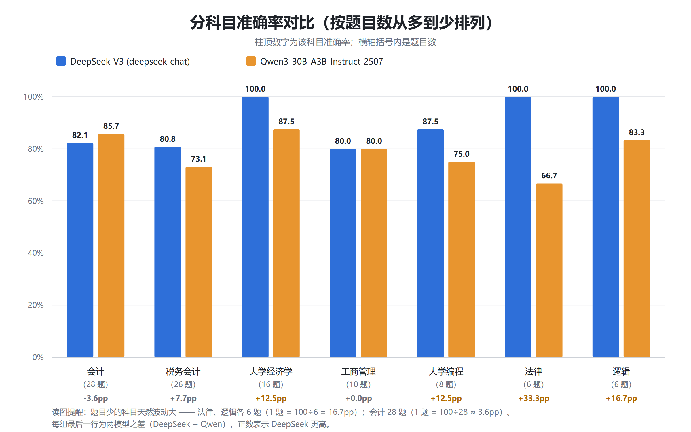

# 财务场景大模型选型评测报告 · C-Eval 双模型对比（v1）

> 版本：v1 ｜ 日期：2026-10-14 ｜ 数据来源：C-Eval 官方 val 集子集（100 题）
> 对比对象：DeepSeek（`deepseek-chat`）× Qwen（`Qwen/Qwen3-30B-A3B-Instruct-2507`）

---

## 1. 评测目的与背景

本评测面向「国产大模型选型」这一实际决策场景：假设企业需要从主流模型中选定一个用于财务知识问答类应用，需要一份客观、可复现的对比依据，用于衡量候选模型在财务类问题上的准确率，以及在其他学科上的表现。

候选模型为 DeepSeek（`deepseek-chat`）与 Qwen（`Qwen/Qwen3-30B-A3B-Instruct-2507`）。两者同属国产主流对话模型，可通过同一平台（硅基流动）调用，且输入单价同档（¥0.8 与 ¥0.7 / 百万 tokens）——只有在调用条件与成本量级一致的前提下，对比结论才具有选型参考价值。

本评测围绕三个问题展开：

1. **谁整体更准？** —— 通过总体准确率判断（详见第 5 节）。
2. **差距集中在哪些科目？** —— 通过分科目准确率定位可能的偏科倾向。
3. **分差是否超出噪声区间？** —— 通过同配置重跑实验确认结论的可靠性（详见 3.3 节与第 8 节）。

---

## 2. 数据集与规模

### 2.1 数据来源

本次评测使用 C-Eval 官方 val 集（HuggingFace `ceval/ceval-exam`），题型为四选一单选、附标准答案。选择公开基准而非自建题目的理由：C-Eval 公开中立、学科覆盖广，可避免「自建题目偏向某一方」的质疑，结论更容易被第三方复核。val 集是官方唯一公开答案的划分（test 集答案不公开，无法自动判分）。

### 2.2 抽样设计

从 269 道备选题中分层抽取 100 题构成正式用卷，抽样遵循四条规则：

- **分层抽样**：财务类主科目 4 个共 80 题（注册会计 28 / 税务师 26 / 经济学 16 / 工商管理 10），对照科目 3 个共 20 题（大学编程 8 / 法律 6 / 逻辑 6）。前者贴合目标业务场景，后者用于观察模型是否存在偏科。
- **答案分布均衡**：A31 / B23 / C24 / D22，避免模型「无脑猜某一选项」也能拿到较高分数，堵住评测设计层面的漏洞。
- **子集固定、可复现**：100 题的构成已固化为数据集文件 `ceval_benchmark100.csv`（随仓库提交），任何人用同一份文件即拿到完全相同的卷子。⚠️ 抽样所用随机种子未固化成脚本，属本次研究的方法学缺口（详见第 9 节第 6 条）。
- **抽样前数据筛查**：剔除 1 组重复题干；并将原始文件编码由 GBK 统一转为 UTF-8（文件经 Excel 转手后编码发生变化）——数据在不同工具间流转会产生隐性变化，探查是评测的前置工序。

| 科目 | 英文名 | 题数 | 角色 |
|---|---|---|---|
| 注册会计 | accountant | 28 | 财务主科目 |
| 税务师 | tax_accountant | 26 | 财务主科目 |
| 经济学 | college_economics | 16 | 财务主科目 |
| 工商管理 | business_administration | 10 | 财务主科目 |
| 大学编程 | college_programming | 8 | 对照科目 |
| 法律 | law | 6 | 对照科目 |
| 逻辑 | logic | 6 | 对照科目 |

### 2.3 规模与局限声明

本次评测共 100 题、覆盖 7 个科目。其中法律、逻辑两科各仅 6 题，单题权重高达 16.7pp，其百分比差异只能作为线索而非结论（详见第 9 节）。

---

## 3. 评测设置

### 3.1 环境与脚本

- 评测日期：2026-10-12 / 10-13
- 调用通道：DeepSeek 走官方 API（`https://api.deepseek.com`），Qwen 走硅基流动（`https://api.siliconflow.cn/v1`）。⚠️ 两模型**并非同平台调用**——服务商的部署形态、量化策略与请求路由不可见，属本次实验的不可控变量（详见第 9 节第 7 条）
- 脚本：`eval_choice.py`（单模型跑测）+ `compare_models.py`（对比统计），仓库 `llm-eval-practice`
- 流程：读题 → 拼装四选一 prompt（要求仅输出选项字母）→ 调 API → 正则提取答案 → 与标准答案精确匹配 → 逐题落盘（保留原始输出）

### 3.2 控制变量表

| 类别 | 项目 | 取值 |
|---|---|---|
| 自变量 | 被测模型 | `deepseek-chat` vs `Qwen/Qwen3-30B-A3B-Instruct-2507` |
| 控制变量 | 题库 | `ceval_benchmark100.csv`，固定 100 题、按 CSV 原序不 shuffle |
| 控制变量 | prompt 模板 | 两模型一字不差（system + user） |
| 控制变量 | temperature | 0.0 |
| 控制变量 | max_tokens | 16 |
| 控制变量 | 采样次数 | 每题 1 次 |
| 控制变量 | 判分规则 | 同一正则 + 精确匹配（见第 4 节） |
| 不可控 | 调用通道 | DeepSeek 官方 API（api.deepseek.com） ↔ Qwen 硅基流动（api.siliconflow.cn/v1），非同平台 |

### 3.3 可复现性实验摘要

对 Qwen 做三轮对照：t=0 首跑 **80.0%**、t=0 重跑 **78.0%**、t=0.7 **79.0%**。同配置重跑时，100 题中 96 题输出字符级一致、4 题答案翻转，波动约 ±2.0pp；温度效应（−1.0pp）小于重跑噪声（−2.0pp）。

**结论：temperature=0 不等于确定性；单次分数是带噪声的估计。** 据此，本报告中差距小于 2pp 的项一律不作为结论。（实验明细见附录 `REPRODUCIBILITY_TEST.md`）

---

## 4. 判分口径与指标体系

### 4.1 答案提取规则（四级兜底）

模型输出为自然语言，需先提取选项字母再判分，提取逻辑设四级兜底：

1. **清洗**：将全角字母统一替换为半角大写字母；
2. **明确句式优先**：优先匹配「答案：D」「选D」等显式句式；
3. **词边界兜底**：匹配第一个前后均非英文字母的独立 A/B/C/D，避免误抓题干中复述的「ABCD」；
4. **失败标记**：四级均未提取成功则标记 `parse_fail`，不计入分母、单独统计。

### 4.2 匹配规则

提取结果与标准答案做**精确匹配**（`==` 判断）。本题型为单选，不存在部分得分。

### 4.3 为什么不用模糊匹配

选择题的答案是离散选项，不存在「部分正确」，模糊匹配只会引入主观判断空间、掩盖真实的判定错误。旁证：本次两个模型的 `parse_fail` 均为 0，说明格式遵循度无差异——分差来自知识层而非格式层，这本身也构成了判分口径有效性的证据。

### 4.4 指标体系

| 指标 | 定义 | 用途 |
|---|---|---|
| 总体准确率 | 答对题数 ÷ 有效题数 | 模型整体能力 |
| 分科目准确率 | 各科目内答对率 | 定位偏科 |
| parse_fail 率 | 提取失败题数 ÷ 总题数 | 指令遵循能力 |
| 分歧题数 | 两模型判断不一致的题数 | 归因分析素材池 |
| 噪声区间 | 重跑实测约 ±2pp | 判断结论是否成立 |

---

## 5. 结果：总体与分科目

| 模型 | 有效题数 / 共 | 准确率 | parse_fail |
|---|---|---|---|
| DeepSeek（`deepseek-chat`） | 100 / 100 | **87.0%** | 0 |
| Qwen（`Qwen/Qwen3-30B-A3B-Instruct-2507`） | 100 / 100 | **80.0%** | 0 |

差值（Qwen − DeepSeek）：**−7.0 pp**，大于噪声区间 2pp，结论成立。

| 科目 | 题数 | DeepSeek | Qwen | 差 |
|---|---|---|---|---|
| business_administration | 10 | 80.0% | 80.0% | +0.0pp |
| tax_accountant | 26 | 80.8% | 73.1% | −7.7pp |
| accountant | 28 | 82.1% | 85.7% | **+3.6pp**（Qwen 唯一反超） |
| college_programming | 8 | 87.5% | 75.0% | −12.5pp |
| college_economics | 16 | 100.0% | 87.5% | −12.5pp |
| law | 6 | 100.0% | 66.7% | −33.3pp |
| logic | 6 | 100.0% | 83.3% | −16.7pp |

**结果解读**：7 个科目中，DeepSeek 在 5 个科目严格领先、1 个科目（工商管理）持平、1 个科目（注册会计）被 Qwen 反超。优势最明显的是法律（−33.3pp）与逻辑（−16.7pp），但这两科样本量仅各 6 题，单题影响达 16.7pp，只能作为线索；会计科目 Qwen 领先 3.6pp，略高于噪声边缘，是否稳定反超需扩大样本验证。

---

## 6. 结果：分歧题与归因

### 6.1 分歧题（21 道）

| 题号 | 标准答案 | DeepSeek | Qwen | 谁答对 |
|---|---|---|---|---|
| accountant#24 | D | D | B | DeepSeek |
| accountant#25 | C | C | A | DeepSeek |
| accountant#27 | D | B | D | Qwen |
| accountant#30 | D | C | D | Qwen |
| accountant#32 | C | B | C | Qwen |
| accountant#43 | B | C | B | Qwen |
| accountant#45 | A | A | B | DeepSeek |
| college_economics#49 | D | D | A | DeepSeek |
| law#18 | A | A | C | DeepSeek |
| college_economics#6 | D | D | B | DeepSeek |
| college_programming#25 | B | B | C | DeepSeek |
| law#8 | A | A | B | DeepSeek |
| logic#8 | B | B | C | DeepSeek |
| tax_accountant#0 | C | C | A | DeepSeek |
| tax_accountant#12 | A | A | B | DeepSeek |
| tax_accountant#40 | C | C | D | DeepSeek |
| tax_accountant#41 | C | B | C | Qwen |
| tax_accountant#44 | A | A | C | DeepSeek |
| tax_accountant#45 | D | B | D | Qwen |
| tax_accountant#46 | D | D | C | DeepSeek |
| tax_accountant#47 | A | D | A | Qwen |

21 道分歧题中，DeepSeek 答对 16 道、Qwen 答对 5 道——只看「两模型判断不一致」的样本，差距被放大到 16:5。以下选取 5 道覆盖不同科目、且均为「一错一对」的分歧题逐题归因。

### 6.2 五道典型分歧题归因

**① law#18 —— 被高显著度干扰项带走（民法 · 按份共有）**

三人按 30/30/40 出资共有货车，甲丙未经乙同意擅自抵押给善意第三人丁并办理登记，问「正确的说法」。标准答案 **A**（无约定时按出资额确定份额）；Qwen 选 **C**（丁善意取得抵押权）。

归因：题干中「不知情」「办理了抵押登记」是善意取得的标志性要件，属**高显著度诱饵**。Qwen 顺着诱饵作答，忽略了本题的基础考点——共有份额的确定规则；且处分人为共有人本人时属有权处分，不符合善意取得（无权处分）的构成前提。**模型抓关键词，没有回到规则本体。**

**② logic#8 —— 干扰项「看似也能解释」（逻辑 · 解释型）**

金雕追击野狼，两周内却只在放飞地 3 公里内飞行，问哪项最能解释。标准答案 **B**（2 公里内有牧羊草场，狼群改去那里觅食）；Qwen 选 **C**（金雕捕杀致野狼几乎灭绝）。

归因：C 制造了「因果通顺」的假象，但与题干前提自相矛盾——题干明说「野狼为觅食活动范围很广」「金雕追击野狼」，若野狼几近灭绝则「追击」这一行为本身不成立。**Qwen 接受了表层合理的解释，未用题干自身约束去排除矛盾项。**

**③ tax_accountant#0 —— 领域方法论题，靠经验不靠推理（税务 · 实务方法）**

「进行税务咨询服务的核心是____」。标准答案 **C**（分析税收政策适用条款）；Qwen 选 **A**（弄清所涉税种）。

归因：A 是流程的**前置步骤**，不是「核心」。税务咨询的价值在于把政策条款正确**适用**到具体情形。这类题答案是行业惯例，缺乏可推演的显式依据，**考的是领域经验密度**——正是 Qwen 落后最集中的题型（tax_accountant 共 26 题，差 −7.7pp）。

**④ college_programming#25 —— 多步状态推演少算一层（数据结构 · 栈）**

6 个元素依次过栈、出栈序列为 cefdba，问栈容量至少为多少。标准答案 **B**（4）；Qwen 选 **C**（3）。

归因：需要逐字符模拟入栈/出栈并跟踪栈内元素数的**峰值**，Qwen 少跟踪了一层深度。此类「精确多步推演」题容易在中间状态上出错，**与知识量无关，是过程精度问题**。

**⑤ college_economics#6 —— 否定式提问下的理论细节判断（宏观经济学）**

「关于宏观经济政策的选择，下列说法**错误**的是____」。标准答案 **D**；Qwen 选 **B**。

归因：B 在主流宏观框架中是正确表述（挤出效应显著时财政政策效果被抵消），本不该被选。Qwen 误把它当作错误项。**否定式提问（问「错误的/不属于的」）要求模型先逐项判定正误再取反**，这一步最容易失分。

### 6.3 三道共性失败模式（Qwen 侧）

1. **干扰项吸引型**（law#18、logic#8）：题目含高显著度、表层合理的诱饵选项，模型顺着诱饵作答，未回到题干约束或规则本体。四道法逻题中三道的失分都源于此。
2. **多步程序推演型**（college_programming#25）：需要逐状态跟踪的题目，中间步骤精度不足。
3. **本土专业领域方法论型**（tax_accountant 系列、law 系列）：答案依赖中国本土法规与实务惯例，通用推理帮不上，考的是领域语料与经验密度。

### 6.4 反向样本 · accountant#27（DeepSeek 也会错）

「不属于 TPS 处理过程的基本活动的是____」。标准答案 **D**；**DeepSeek 选 B（错），Qwen 选 D（对）**。

归因：TPS 基本活动本包含数据库维护，DeepSeek 误判为「不属于」。这说明**基线模型同样存在「否定式提问 + 术语辨析」的盲区**——结论不能说成「DeepSeek 全面更强」，只能说「在这 100 题上整体领先」。

### 6.5 可能原因

- **模型架构与规模差异**：Qwen3-30B-A3B 为 MoE 架构（总参 30B、每 token 激活约 3B），DeepSeek 服务模型规模未公开。分歧题集中出现在「需要精确领域知识 + 多步推理」的题型上，与上述架构特征方向一致。
- **服务商部署差异（代码不可控）**：DeepSeek 走官方直连，Qwen 走硅基流动聚合平台，实际推理可能采用量化部署，会影响能力表现。
- **温度=0 的残余随机性**：主对比基于单次运行，未做多轮重复取均值。
- **样本量限制**：法律、逻辑各仅 6 题，两科百分比差异不具统计意义，只能作为线索。

---

## 7. 成本与调用量

| 模型 | API 调用次数 | Tokens | 账面花费 | 实付 |
|---|---|---|---|---|
| `deepseek-chat` | 147（含开发调试 47 次，有效评测 100 次） | 26,914 | ¥0.02 | ¥0.02 |
| `Qwen3-30B-A3B-Instruct-2507` | 300（100 题 × 3 轮实验） | 45,687 | ¥0.03 | ¥0.00（代金券全额抵扣） |
| **合计** | **447** | **72,601** | **¥0.05** | **¥0.02** |

**成本解读**：平均单次调用约 152–183 tokens。C-Eval 题干较短，且输出被限制为 16 tokens（只返回选项、不含解题过程），因此**成本主要由输入构成、输出被主动限死**——这也是评测场景控制成本的关键设计。折算下来单题成本约 ¥0.0001–0.0002，一套 100 题规模的评测单轮 API 成本仅几分钱、几分钟即可跑完。

调用次数的差异需要说明：DeepSeek 共 147 次，超出有效评测 100 次的部分为开发期冒烟测试与调试调用；Qwen 为 300 次，即 100 题 × 3 轮实验（首跑 + 同配置重跑 + 温度对比）。**区分「有效调用」与「总调用」是评测工程的基本习惯**，成本与调用量也应如实记录。

---

## 8. 结论与建议

**总体结论**：在本题库、本提示词、本判分口径下，DeepSeek 准确率 87.0%，高于 Qwen 的 80.0%，差 7.0pp，大于实测噪声区间 2pp——「DeepSeek 整体领先」的结论成立。

**分科目结论**：差距小于 2pp 的项落在噪声内，不作为结论——工商管理两模型持平（±0.0pp）；注册会计 Qwen 领先 3.6pp，略高于噪声边缘，仅能视为「可能相当或略优」，需扩大样本验证。法律、逻辑两科差距较大但样本量过小，只能作为线索。

**选型建议**：若业务以税务、法律类问答为主，建议先做专项评测再定；若为通用财务知识问答场景，DeepSeek 是当前更优选择。此外，两模型在本评测中格式遵循度一致（`parse_fail` 均为 0），工程接入难度上无差别，选型可主要依据业务语料匹配度与成本。

---

## 9. 局限与不可控因素

1. **单次采样**：主对比为每题 1 次调用，未做多次取均值；可复现性实验已提示单次分数带噪声。
2. **小样本科目**：法律、逻辑各仅 6 题，±1 题即 ±16.7pp，百分比差异不具统计意义。
3. **噪声估计本身样本少**：仅 2 次重跑，只能说「观察到约 2pp 波动」，不能断言「噪声就是 2pp」；要测准需更多轮次。
4. **公开基准 ≠ 垂域评测**：C-Eval 覆盖不了企业真实财务场景，结论需结合自建评测集（项目一）交叉验证。
5. **未做消融实验**：prompt 模板措辞、`max_tokens=16` 等设置对结果的影响未单独验证，此类参数差异可能影响分数。
6. **抽样过程未固化为脚本**：从 269 题池分层抽取 100 题的过程没有留下可重跑的代码，随机种子未记录；复现依赖随仓库提交的固定数据集文件，而非「重跑抽样代码」。这是本次研究在可追溯性上的缺口。
7. **两模型非同平台调用**：DeepSeek 走官方 API、Qwen 走硅基流动聚合平台，两边的部署形态、是否量化、请求路由策略均不可见，属不可控变量。因此本结论适用于「以该接入方式调用的这两个模型」，**不等于两个模型自身能力上限的对比**。

---

## 附录

- 实验记录：`REPRODUCIBILITY_TEST.md`（可复现性与温度对照）
- 明细数据：`benchmark_deepseek.csv` / `benchmark_qwen.csv` / `benchmark_qwen_t0_rerun.csv` / `benchmark_qwen_t07.csv`
- 脚本：`eval_choice.py` / `compare_models.py`
- 上一版报告：`COMPARE_REPORT_v0.md`
- 数据集：`evaluation/datasets/ceval_benchmark100.csv`（100 题 × 7 科目，本次正式用卷）；源池与数据质量探查结论见 `C-Eval数据探查报告.md`（抽样脚本未留存，见第 9 节第 6 条）
